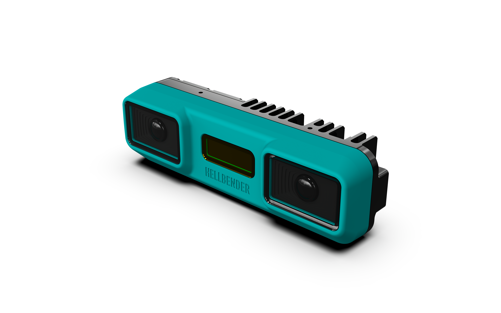

# Hellbender Stereo Camera

The Hellbender Stereo Camera is a fully programmable depth perception module, bolstering stereo vision with onboard compute and AI acceleration. This repository holds examples and other resources to assist with development.

## Firmware Releases & Documentation Index

The table below contains user documentation in PDF and HTML for each firmware release:

| Software Version | Download Link | Release Date | Documentation | Release Notes |
|---|---|---|---|---|
| v2.0 | [link](https://docsend.com/view/s/57nkn89h5e3pt7y7) | 2026-09-01 | [HTML](https://hellbenderinc.github.io/hellbender-product-documentation/stereo-cam/2.0/) | Initial public release|

For each version of the documentation, there is an OS image available for download [here](https://docsend.com/view/s/57nkn89h5e3pt7y7). 

NOTE: The link to OS image downloads requires email verification. Emails used to purchase units are already authorized, but a Hellbender admin will grant access if entering your email produces an 'Unable to authorize' message, and your email domain is familiar. Please email [products@hellbender.com](mailto:products@hellbender.com?subject=Stereo%20GitHub%20Page%20Inquiry) with any questions.

## External Software Resources

The Hellbender Stereo Camera is an open access platform running a linux-based OS with container support for easy application development and testing. Check out the links below for development tools and resources:

- See Hailo's [GitHub repo](https://github.com/hailo-ai/hailo-apps) with links to [user](https://github.com/hailo-ai/hailo-apps/blob/main/doc/user_guide/README.md) and [developer](https://github.com/hailo-ai/hailo-apps/blob/main/doc/developer_guide/README.md) guides for AI-enabled application development

## Support

For questions, visit out our [support forum](https://github.com/HellbenderInc/hellbender-stereo-camera/discussions) or contact us at [support@hellbender.com](mailto:support@hellbender.com?subject=Stereo%20GitHub%20Page%20Inquiry).
